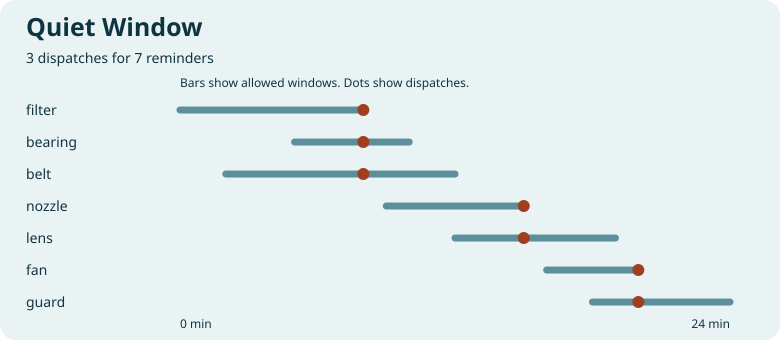

# Quiet Window

Maintenance reminders often arrive one at a time. Quiet Window groups them into the fewest dispatches while keeping every reminder within its allowed delivery window. It reads a local CSV and prints the plan without sending messages.



## Run the demo

Use Python 3.10 or later in this folder.

```bash
python3 quiet_window.py reminders.csv --svg timeline.svg
```

The synthetic fixture produces **3 dispatches for 7 reminders**, down from 7 if each reminder were dispatched individually. The shared times are minutes **8, 15, and 20**. Every assignment falls inside its inclusive window.

## How it works

Sort windows by their deadline. Dispatch at the first uncovered deadline and group every subsequent reminder whose window includes that time. Any solution needs a dispatch in the earliest-ending uncovered window. Moving that dispatch to the window's deadline preserves coverage of any later-ending window it already covered. Repeating the argument gives a minimum count. Sorting takes O(n log n) time and sweeping the sorted windows takes O(n) time.

The fixture uses nonnegative integer minutes relative to a common start and a unique ID per reminder. The planner assumes all windows are known before it runs and allows any number of reminders per dispatch. A live service would need a policy for new arrivals, delivery failures, capacity limits, and urgent alerts.

## Validate

```bash
python3 -m unittest -v
```
