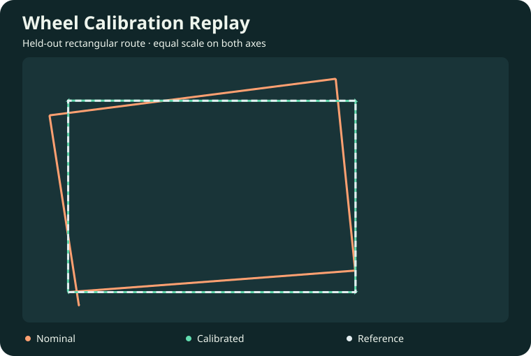

# Wheel Calibration Replay

A differential-drive robot can drift even when both wheels report the expected encoder counts. This demo estimates an effective distance per tick for each wheel and an effective track width from measured motions, then replays a separate encoder log to quantify the change in odometry error.



## Run the demo

From this directory, run these commands with Python 3.10 or newer.

```bash
python3 replay.py fixture.json --svg trajectories.svg
PYTHONDONTWRITEBYTECODE=1 python3 -m unittest -v
```

The CLI prints the fitted parameters and regenerates the SVG. On the supplied synthetic fixture, position RMS across the nine reference poses falls from **9.25 cm to 0.08 cm**. The measured reference coordinates are used only to score the replay. One straight calibration trial contains intentionally corrupted counts.

## Design

Each straight trial pairs a known travel distance in meters with signed left and right tick counts. The median of distance divided by ticks provides a separate scale for each wheel. Each turn then estimates the track width as calibrated right distance minus calibrated left distance, divided by the signed reference angle in radians. The median of these track estimates is used in the replay.

The replay treats each pair of tick increments as one constant-curvature segment. It computes heading change from the wheel distance difference, then integrates the segment as an arc. The tests cover a quarter-circle with one stationary wheel and the full rectangular replay.

## Limitations

The fixture uses exact synthetic reference positions with rounded ticks. Real wheel slip, uneven surfaces, reference measurement error, and changes in load can produce much larger errors. The median tolerates a minority of corrupted training trials. Persistent bias or slip requires better measurements or a separate sensor. This offline prototype estimates position from encoder logs alone.
