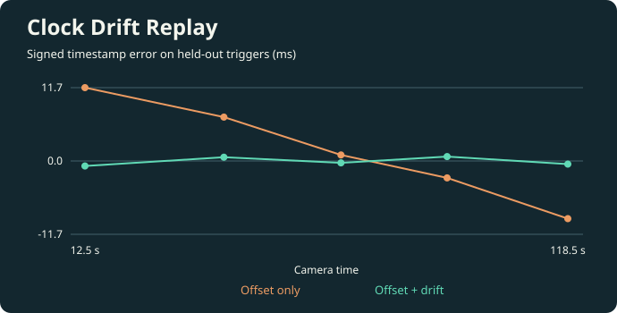

# Clock Drift Replay

After a civilian aerial survey, a camera and a separate light sensor logger can disagree about when a frame was captured. This offline demo uses shared trigger timestamps to translate the camera clock onto the logger clock. Both logs are represented by synthetic paired timestamps, with seconds measured from local clock origins.



## Run the demo

From this directory, run the command with Python 3.10 or newer.

```bash
python3 align.py survey.json --svg residuals.svg
```

The command prints the fit and regenerates the chart. On five held-out triggers, adding a drift term lowered timestamp RMS error from **7.466 ms to 0.605 ms**. The fitted logger clock runs 200 parts per million faster than the camera clock and starts 0.4000 seconds ahead in the synthetic fixture. The held-out pairs include sub-millisecond timestamp jitter.

## Design

The first set of pairs contains matched sync events with one intentionally corrupted logger timestamp. The fitter takes the median slope across all pairs of sync events and then takes the median intercept for that slope. The baseline adds the median logger-minus-camera offset. Both fits use only sync events. The plot and RMS score use the second set of pairs, with signed error measured as predicted logger time minus recorded logger time.

## Limitations

The prototype assumes the trigger pairs are already matched and the relative clock rate stays constant. It models neither clock resets nor changing drift. It also uses a quadratic number of pairwise slopes, so it is intended for short calibration logs.
